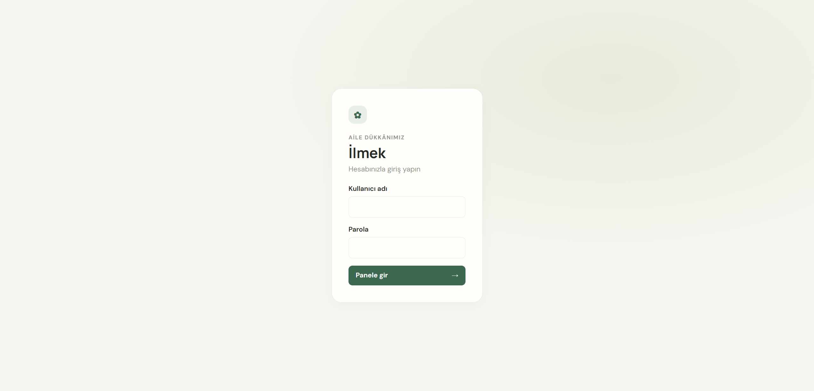
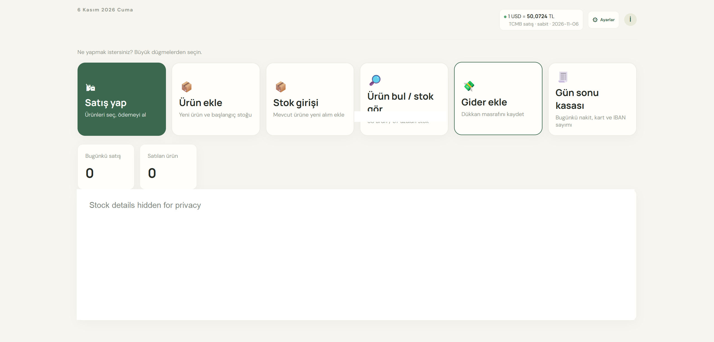
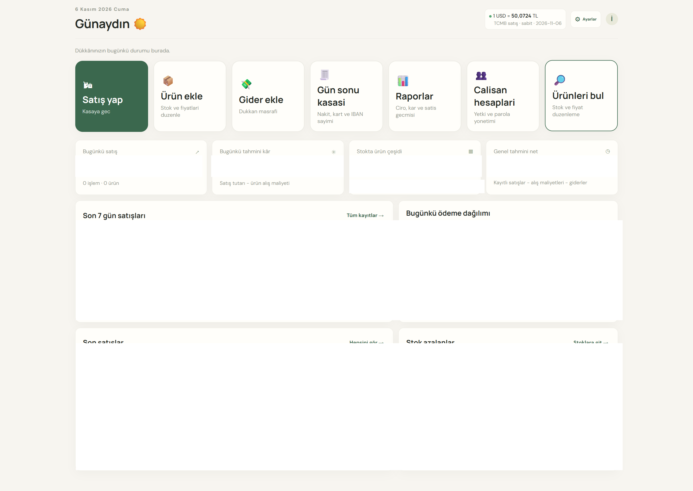

# Ilmek - Inventory and Sales Management for Haberdashery Shops

Ilmek is a self-hosted web app that helps small shops manage products, stock, and sales from one interface. The UI works on phones and tablets. The application interface is currently in Turkish.

> **Privacy:** This repository does not include a store database, backups, product photos, supplier receipts, or a real store address. The app creates its database when you run it.

## Screenshots

### Sign-in



### Staff dashboard



### Admin dashboard



Dashboard screenshots have been redacted to hide store-specific information.

## Features

- Manage products, categories, purchase costs, sale prices, and stock
- Record cash, card, or bank-transfer sales and update stock automatically
- Separate administrator and cashier accounts with role-based permissions
- Review sales, payment methods, expenses, estimated gross profit, and low-stock reports
- Track product photos, stock purchases, stock adjustments, and activity history
- Calculate prices using the daily USD/TRY exchange rate published by the Central Bank of the Republic of Türkiye (CBRT)
- Use SQLite, local ZIP backups, and optional Google Drive backups
- Choose between the Python server or the PHP/MySQL cPanel deployment

Tax calculation, partial payments, and partial refunds are not currently supported.

## Quick start (Windows)

1. Install [Python 3.11 or later](https://www.python.org/downloads/).
2. Download or clone this repository.
3. Double-click `start.bat`, or run `python server.py` from the project directory.
4. Open `http://127.0.0.1:8000` in your browser.
5. Follow the on-screen instructions to create your administrator account.

The Python server uses only the standard library; no `pip install` step is required. The app creates its database and backups in its data directory. Do not commit live store data.

## Run on Linux

With Python 3.11 or later installed:

```sh
python3 server.py
```

The default port is `8000`; set the `PORT` environment variable to use a different port. For access from other devices or over the internet, use an HTTPS reverse proxy. Do not expose `stok.db`, `backups/`, or `images/` through the web server.

## Deployment

- **Docker + Caddy (Linux VPS):** [deploy/README.md](deploy/README.md)
- **PHP + MySQL (cPanel):** [deploy/CPANEL.md](deploy/CPANEL.md)

Both deployment options use the same interface but have different database and setup requirements. Configure real passwords, setup tokens, and Google Drive OAuth credentials only on your server. Never commit `.env` files or private configuration files.

## Data and backups

The Python version uses SQLite. `stok.db`, `backups/`, and `images/` may contain private store data and are excluded by `.gitignore`. Keep a separate, secure copy of your backups. Never add a real database, export, or backup to a public GitHub repository.

Google Drive backup is optional. If you enable it, provide OAuth credentials through environment variables; never place them in source code or commit them to the repository.

## Project structure

```text
.
├── app.js, style.css, index.html    # Web interface
├── server.py                       # Python + SQLite server
├── start.bat                       # Windows launcher
├── passenger_wsgi.py               # Passenger/WSGI entry point
├── cpanel-php/                     # PHP API and MySQL version
├── deploy/                         # Docker, Caddy, and deployment guides
└── screenshots/                    # Project screenshots
```

## License

This project is distributed under the [MIT License](LICENSE).
